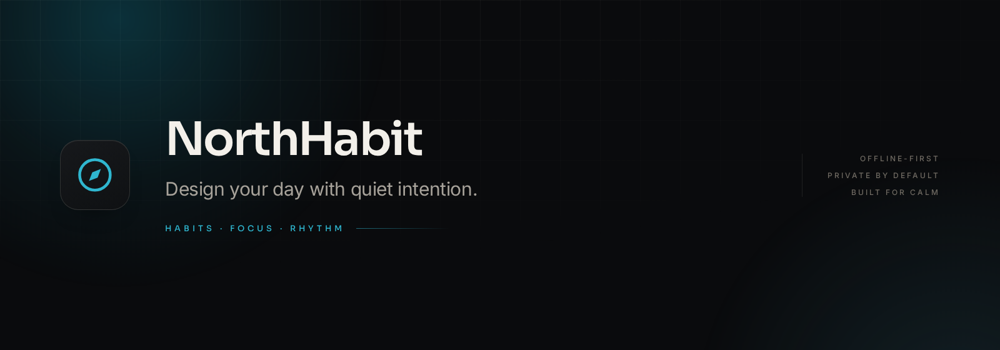
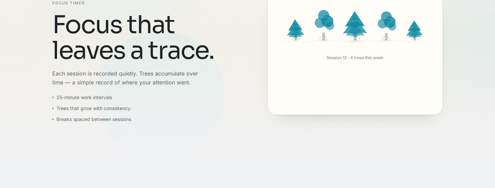
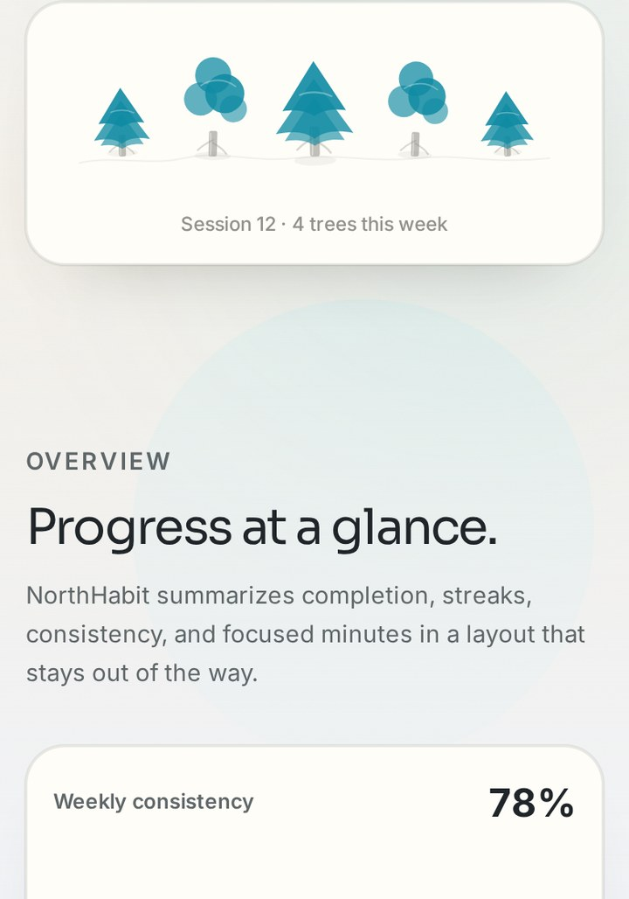
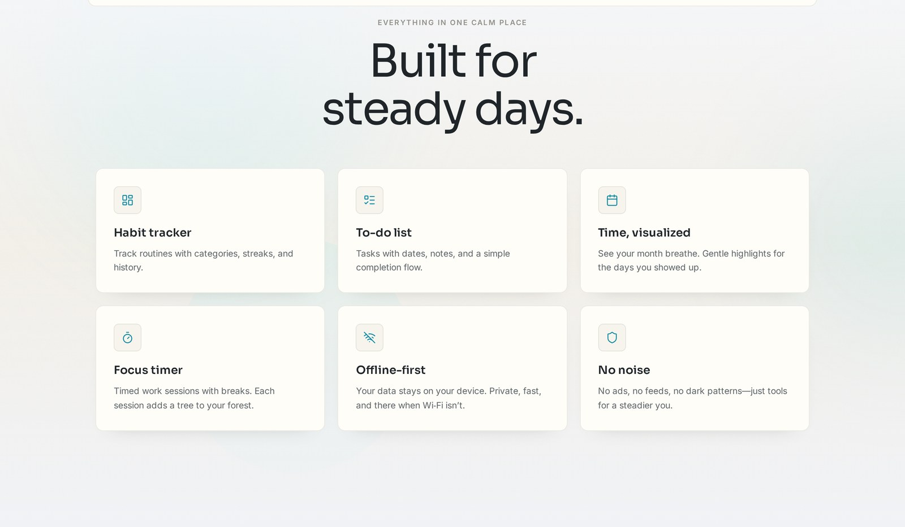

 

**A private workspace for habits, tasks, focus and time.**

Habit tracking, a Pomodoro focus forest, a calendar and daily notes — in one
offline-first app that stays out of the way.

[Live app](https://northhabit.pages.dev) · [Design system](DESIGN.md) · [Security](SECURITY.md)

---

## Overview

NorthHabit is a single-page web app built around one idea: productivity should
feel calm, not demanding. Everything is local-first, so the app keeps working
without a connection and never asks for more than it needs.

- **Habits** — daily routines with streaks, categories and completion history.
- **Tasks** — a to-do list with dates, notes and a simple completion flow.
- **Focus** — a Pomodoro timer that grows a tree for every completed session.
- **Calendar** — a month view that shows where your attention actually went.
- **Soundscapes** — rain, forest, café and white noise, generated or streamed.

## Preview

<table>
  <tr>
    <td width="70%"></td>
    <td width="30%"></td>
  </tr>
  <tr>
    <td align="center">Focus timer — every session adds a tree to the forest</td>
    <td align="center">Mobile — progress at a glance</td>
  </tr>
</table>

## Tech stack

| Layer | Choice |
| --- | --- |
| Framework | React 19 + TypeScript 5.8 |
| Build | Vite 6 |
| Styling | Tailwind CSS 4 with CSS custom-property theming |
| Animation | Motion (Framer Motion) |
| Icons | Lucide |
| Auth & sync | Firebase Authentication + Firestore (optional) |
| Hosting | Cloudflare Pages |
| Offline | Service worker + local storage |

## Author

**Soumil Malviya** — [github.com/soumil-malviya](https://github.com/soumil-malviya)
